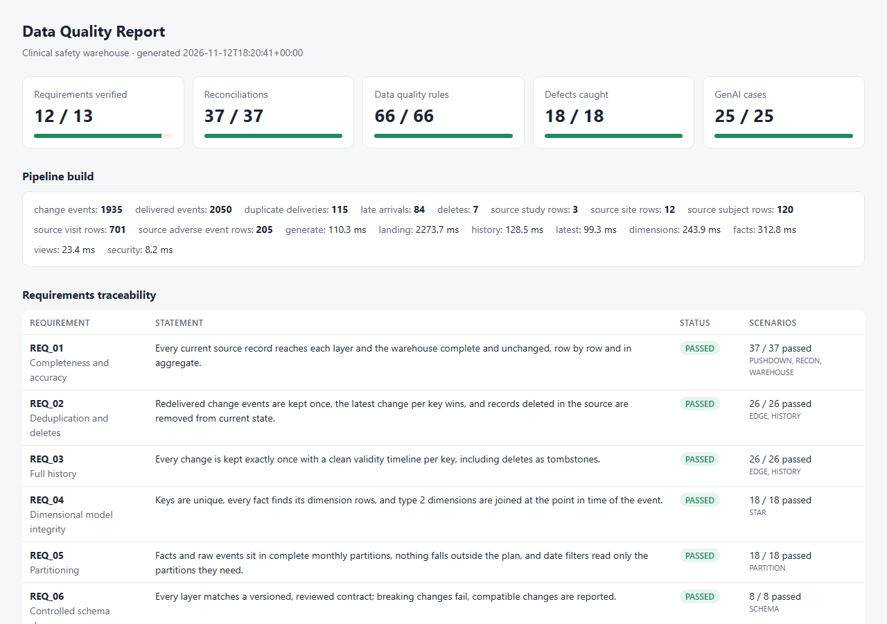
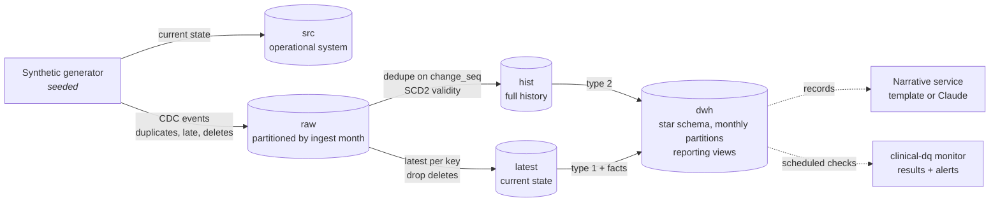

<div align="center">

# Clinical Data & AI Test Automation

**Automated tests that prove a clinical data warehouse tells the truth,
and that an AI summary of that data does not make things up.**


-D97757)


</div>

---

**Contents:**
[In plain words](#in-plain-words) ·
[Run all the tests](#run-all-the-tests) ·
[Read the result](#read-the-result) ·
[The tests explained](#the-tests-explained) ·
[How a test is written](#how-a-test-is-written) ·
[For engineers](#for-engineers) ·
[Maintenance](#-maintenance--planned-updates) ·
[License](#license)

## In plain words

During a clinical trial, every side effect a patient has (an **adverse event**: a headache, a rash, a
heart problem) is recorded in the trial's system. That data is copied into a **data warehouse**, where
doctors and safety teams read reports from it: how many events, how many serious, in which study.
An AI can also write a short **summary** of each patient's events.

If the copy is wrong, the reports are wrong. A side effect can be counted twice, a corrected record can
keep its old value, a deleted record can still show up, a serious event can be left out of a summary.
In this field, those are not cosmetic bugs.

This project builds a small warehouse filled with **fake (synthetic) patient data**, then runs
**243 automated tests** that check, in many different ways, that nothing was lost, duplicated, changed
or invented on the way.

**A few words used below:**

| Word                  | Meaning                                                                                                     |
|-----------------------|-------------------------------------------------------------------------------------------------------------|
| **Source system**     | Where the data is first recorded. The tests treat it as the truth.                                          |
| **Warehouse**         | The copy that reports read from. Built in **layers**, one step at a time.                                   |
| **Change feed (CDC)** | The stream of every insert, update and delete in the source. It can deliver the same change twice, or late. |
| **History**           | Every version a record ever had, with the time each version was valid.                                      |
| **Latest**            | Only the current version of each record.                                                                    |
| **Fact / dimension**  | Facts are events (an adverse event, a visit). Dimensions describe them (the patient, the study, the site).  |
| **Partition**         | A table split into monthly pieces, so a question about September reads only September.                      |
| **Reconciliation**    | Comparing two copies of the same data, row by row and column by column.                                     |
| **Scenario**          | One test, written in plain English (Gherkin), so non-programmers can read it.                               |

## Run all the tests

You need two free programs: **Docker Desktop** (runs the database) and **Python 3.15**. No account, no
API key and no AI tool is needed.

1. Start Docker Desktop and wait until it says it is running.
2. Open a terminal in this folder.
3. Copy these lines, one at a time:

```bash
docker compose up -d                              # starts the database (Postgres) in Docker
python -m venv .venv                              # creates a private Python environment
.venv/Scripts/activate                            # Windows. On Mac/Linux: source .venv/bin/activate
pip install -c constraints.txt -e ".[test,dev]"   # installs the exact tested versions of everything
pytest                                            # runs every test (about one minute)
```

**What success looks like:** the last line says `242 passed, 1 skipped`. The skipped test is the only
one that calls a real AI model; it runs only when you ask for it, because it costs money.

**Faster:** `pytest -n auto` runs the tests in parallel (about 40 seconds).

**If something goes wrong:**

| You see                                                          | Do this                                                                                                                                    |
|------------------------------------------------------------------|--------------------------------------------------------------------------------------------------------------------------------------------|
| `Database not reachable ... Start it with: docker compose up -d` | Docker Desktop is not running, or step 3's first line was skipped.                                                                         |
| `port is already allocated`                                      | Something else uses port 55432. Stop it, or change the port in `docker-compose.yml`, copy `.env.example` to `.env` and set `DB_URL` there. |
| `activate` is not recognised                                     | On Mac/Linux use `source .venv/bin/activate`.                                                                                              |

## Read the result

Open **`reports/data-quality-report.html`** in a browser. It is the only report you need to read:

<p align="center">
  
</p>

- **The cards at the top** count what passed: requirements verified, reconciliations, data quality
  rules, defects caught, AI cases.
- **Requirements traceability:** every requirement of the system and the tests that prove it.
- **Reconciliation:** every comparison between two copies of the data. A failure lists the exact rows.
- **Data quality rules:** every rule, the SQL it ran, and the bad rows it found.
- **Defect injection:** the bugs planted on purpose, and the test that caught each one.
- **GenAI evaluation:** how every AI summary scored.

For auditors, the same run also writes `traceability-matrix.csv`, `data-quality-report.json` and
`cucumber.json`. `clinical-dq evidence` freezes them with tamper-evident hashes.

## The tests explained

The 243 tests come in four kinds:

| Kind                  | Tests | Where                                     | What they are                                                                                                                         |
|-----------------------|------:|-------------------------------------------|---------------------------------------------------------------------------------------------------------------------------------------|
| **Scenarios**         |   182 | [`tests/features/`](tests/features)       | The warehouse checks, written in plain English for stakeholders. Explained one by one below.                                          |
| **Property tests**    |     3 | [`tests/property/`](tests/property)       | Hypothesis generates 40 random change feeds per test and checks that history, latest and incremental loads always hold their rules. |
| **Tool checks**       |    39 | [`tests/quality/`](tests/quality)         | 31 BigQuery checks: one test covers all 123 SQL files (each runs on BigQuery or says why not), 26 check each BigQuery file, 4 check partitioning and the export. 8 check the CI helpers: which tests a change selects, flaky-test detection. |
| **Unit tests**        |    19 | [`tests/unit/`](tests/unit)               | Single pieces of Python in isolation: the reconciliation engine, the data generator and evaluator, the Claude request.               |

A normal run shows `242 passed, 1 skipped`: the skipped scenario calls Claude for real and runs only when asked.

The 182 scenarios live in 15 files in [`tests/features/`](tests/features), written in plain English.
Each one below answers: **what could go wrong**, and **how the test proves it did not**.

**1. [The test data](tests/features/01_test_data.feature)** (3 scenarios)
*Could go wrong:* tests pass only because the data is too clean to cause trouble.
*How it is checked:* the fake data is generated with a fixed seed, so it is identical every time,
and contains the hard cases on purpose: changes delivered twice, changes arriving late, records
deleted in error. The scenarios count them exactly.

**2. [Schema contracts](tests/features/02_schema_contracts.feature)** (8)
*Could go wrong:* someone drops or renames a column, and every report reading it breaks.
*How:* the shape of each layer (tables, columns, types) is written down in a reviewed file. The
database must match it. Harmless changes (a new optional column) are reported; breaking ones fail.

**3. [Reconciliation](tests/features/03_reconciliation.feature)** (24)
*Could go wrong:* a record is lost, duplicated or changed between the source and the warehouse.
*How:* each layer is compared with the one it was built from, matching rows by their ID and
comparing every column. Totals per study and per month are compared too.

**4. [History and latest](tests/features/04_history_and_latest.feature)** (16)
*Could go wrong:* a change delivered twice is stored twice; a deleted record keeps showing up; the
history of a record has gaps or overlapping versions.
*How:* rules check one row per record in "latest", every change exactly once in "history", a clean
timeline per record, and that deleted records are gone from "latest" but kept in "history".

**5. [The star schema](tests/features/05_star_schema.feature)** (18)
*Could go wrong:* a fact points to a patient or site that does not exist; an event is linked to a
site's current investigator instead of the one in charge when it happened.
*How:* every link from a fact to its dimension is checked, IDs must be unique, and each event must
point to the version of the site that was valid on the day of the event.

**6. [Partitions](tests/features/06_partitions.feature)** (18)
*Could go wrong:* a month is missing; a row lands in the wrong month; a question about one month
reads the whole table (slow and expensive at scale).
*How:* every month must have its partition; rows dated the last day of September and the first of
October must land in different partitions; the database's own query plan must show that a
September question reads only September.

**7. [Safety figures](tests/features/07_safety_figures.feature)** (8)
*Could go wrong:* a report shows a different number than the clinical system.
*How:* the questions a safety doctor asks (events per study, per grade, serious events) are asked of
both the source and the warehouse. The answers must be identical.

**8. [Planted bugs](tests/features/08_defect_injection.feature)** (19)
*Could go wrong:* a test that has never failed may not be able to fail.
*How:* 18 realistic bugs (a duplicate, a lost delete, a wrong join, a dropped column, an e-mail
address leaked into the data...) are planted, one at a time, in a separate copy of the warehouse.
Each must be caught by the test written for it.

**9. [AI summaries](tests/features/09_genai_narratives.feature)** (18)
*Could go wrong:* the AI miscounts, invents an event, or forgets to say an event was serious.
*How:* each example lists a patient's events in a table and states what the summary must say. Every
summary is checked against the records: counts, highest grade, no invented events, serious events
mentioned. If the AI service is down, the system must still answer, from a simple template.

**10. [Incremental loads](tests/features/10_incremental_loads.feature)** (16)
*Could go wrong:* real systems load only the new data each night; that path can drift from a full
rebuild, or double things up when a job is re-run.
*How:* a second warehouse is built the incremental way and compared with the full build, table by
table. Re-running the same load must change nothing.

**11. [Edge cases](tests/features/11_change_feed_edge_cases.feature)** (10)
*Could go wrong:* rare timing situations: an old change arriving after a newer one, two changes at
the same second, a change at midnight or across a daylight-saving switch.
*How:* each scenario writes a few events by hand, in a table, and states exactly what history and
latest must contain. Each runs twice: all at once, and in two loads.

**12. [Fast reconciliation](tests/features/12_pushdown_reconciliation.feature)** (5)
*Could go wrong:* comparing every row is too slow for billions of rows.
*How:* the database computes a fingerprint per group of rows; only groups whose fingerprints differ
are compared row by row. Tests prove it gives the same answer as the full comparison.

**13. [Monitoring](tests/features/13_production_monitoring.feature)** (4)
*Could go wrong:* in production, a data feed silently stops, loses batches, or starts sending odd values.
*How:* `clinical-dq monitor` runs all checks plus freshness, volume and drift checks, stores the
results and sends an alert. Three incidents are simulated; each must raise an alert.

**14. [Compliance](tests/features/14_compliance.feature)** (5)
*Could go wrong:* personal data leaks into the warehouse; an analyst can see names they should not;
nobody can prove which test covers which requirement.
*How:* scans for personal data, checks what an analyst role can and cannot read, verifies every
requirement in [`docs/requirements.json`](docs/requirements.json) has tests, and checks that
evidence files cannot be changed without it being noticed.

**15. [AI at scale](tests/features/15_genai_at_scale.feature)** (10)
*Could go wrong:* a few examples look fine, but the AI is worse across hundreds of patients; or a
small dip in score is mistaken for a real problem.
*How:* 127 cases (every patient plus tricky variants) are scored and stored. A drop counts as a
regression only if a statistics test says it is real. An AI judge is trusted only after it agrees
with human ratings.

**Plus three folders of technical tests:**
[`tests/property/`](tests/property) generates hundreds of random change feeds and checks that the
rules always hold (it found a real bug during development);
[`tests/quality/`](tests/quality) checks the test tooling itself and that all SQL runs on BigQuery;
[`tests/unit/`](tests/unit) tests small pieces of code without a database.

## How a test is written

```gherkin
Scenario Outline: Every <fact>.<fk> finds its row in <dim>
  When I run the check "sql/checks/rules/keys/referential_integrity.sql" with:
    | layer | fact   | fk   | dim   | pk   |
    | dwh   | <fact> | <fk> | <dim> | <pk> |
  Then it finds no offending rows
```

- The scenario names the **SQL file** it runs. Open it to see exactly what is checked.
- A check returns the **bad rows**. No rows means the check passed; if it fails, the report shows the
  bad rows and the SQL that found them.
- Short SQL is written straight into the scenario; longer SQL lives in a file under [`sql/`](sql),
  one query per file.

To run one area only: `pytest -m recon` (or `history`, `partition`, `genai`... see
[Running parts](#running-parts-of-the-suite)). To run one scenario: `pytest -k "deleted"`.

---

## For engineers

### Architecture



`latest` and `hist` are both built from `raw`, independently, so two derivations of the same current
state must agree. The warehouse is tested only in SQL; Playwright tests the narrative service, the
one HTTP component.

### Built for production

| Concern               | How it is handled                                                                                                                                                                                                                                                      |
|-----------------------|------------------------------------------------------------------------------------------------------------------------------------------------------------------------------------------------------------------------------------------------------------------------|
| Volume                | Reconciliation compares checksums per bucket of keys inside the database and fetches only differing buckets (0 of 10,702 rows on a clean build)                                                                                                                        |
| Incremental loads     | `sql/incremental/` MERGEs each batch; equal to a full rebuild, idempotent, safe with out-of-order data                                                                                                                                                                 |
| Unknown edge cases    | Hypothesis property tests on random feeds (ties, late arrivals, redeliveries, deletes, re-inserts)                                                                                                                                                                     |
| Live data             | `clinical-dq monitor`: every check plus freshness, volume and drift; results in `qa_monitor.check_results`; webhook alerts                                                                                                                                             |
| Schema change         | Versioned contracts with owner and consumers; compatible changes bump the minor version, breaking ones fail                                                                                                                                                            |
| Parallel, hermetic CI | Each xdist worker and CI run gets its own database; `clinical-dq affected` selects tests by changed files; `--record-results` tracks flaky tests                                                                                                                       |
| Regulated data        | Personal-data scans, role-based column access, requirements traceability, SHA-256 evidence packs                                                                                                                                                                       |
| GenAI quality         | 127-case versioned evaluation set, scores per model and prompt version, z-test for regressions, cost and latency budgets, judge calibrated by Cohen's kappa                                                                                                            |
| BigQuery              | 24 hand-written counterparts (partitioning, clustering, `FARM_FINGERPRINT`, `INFORMATION_SCHEMA`), 56 transpiled with sqlglot, 43 not needed with the reason; `clinical-dq bigquery` exports the build. Validated offline; not executed (needs a Google Cloud project) |
| Code quality          | ruff, sqlfluff (keyword case, ambiguous joins, unused CTEs) and mypy, enforced in CI                                                                                                                                                                                   |

### The `sql/` folder

```
sql/
├── build/              the warehouse, in number order: landing/ history/ latest/ dimensions/ facts/ views/ security/
├── incremental/        MERGE-based batch loads for history and latest
├── checks/
│   ├── rules/          keys/ history/ partitions/ values/ privacy/  (each returns offending rows)
│   ├── recon/          <category>/<check>/source.sql + target.sql
│   ├── recon_engine/   bucket checksums and drill-down (push-down reconciliation)
│   ├── monitoring/     freshness, volume, drift
│   ├── build_compare/  compare two builds by business key
│   └── schema/         catalogue queries behind the contracts
├── contracts/          latest.json, hist.json, dwh.json (versioned, with owner and consumers)
├── defects/            planted bugs, one per file, by category
├── incidents/          production incidents for the monitoring tests
├── schema_changes/     compatible schema changes for the contract tests
├── fixtures/           the sandbox for hand-built change feeds
├── results/            tables that store check, test and GenAI results
├── queries/            the questions the scenarios ask
└── dialects/bigquery/  BigQuery counterparts + manifest.json (what is not needed, and why)
```

Placeholders: `{src} {raw} {hist} {latest} {dwh}` for the layer schemas (the planted-bug tests build a
`mut_` copy), `{table}`-style identifiers from the scenario's data table, `:name` bind parameters.
The first comment line of a rule, reconciliation or planted bug is its description in the report.

### The CLI

```bash
clinical-dq build                       # generate data and build every layer
clinical-dq check                       # every reconciliation, rule and contract; write the report
clinical-dq defects                     # list the bugs that can be planted
clinical-dq inject wrong_site_version   # plant one in the main build, then `check` to see it caught
clinical-dq contract                    # refresh sql/contracts/ after a deliberate schema change
clinical-dq monitor                     # every check + freshness, volume, drift; store; alert
clinical-dq eval                        # GenAI evaluation set: scores stored, real regressions flagged
clinical-dq affected --since origin/main   # the pytest command for the tests a change can affect
clinical-dq evidence                    # freeze the last run's reports with SHA-256 hashes
clinical-dq bigquery                    # write the BigQuery build and report SQL coverage
clinical-dq serve                       # narrative service on http://127.0.0.1:8000/docs
```

### Running parts of the suite

| Command                                       | Runs                                          |
|-----------------------------------------------|-----------------------------------------------|
| `pytest -m recon` / `-m pushdown`             | reconciliations / fast reconciliation         |
| `pytest -m "history or star"`                 | layer and star schema checks                  |
| `pytest -m partition`                         | partitions                                    |
| `pytest -m "incremental or edge or property"` | incremental loads, edge cases, property tests |
| `pytest -m schema` / `-m mutation`            | contracts / planted bugs                      |
| `pytest -m monitoring` / `-m compliance`      | monitoring / compliance                       |
| `pytest -m "genai or genai_scale"`            | AI evaluation, offline                        |
| `pytest -m quality` / `-m unit`               | tooling tests / no-database tests             |
| `pytest -m REQ_05`                            | everything that verifies one requirement      |

The full quality gate, as CI runs it:

```bash
ruff check src tests conftest.py && ruff format --check src tests conftest.py
sqlfluff lint sql
mypy
pytest -n auto
```

### GenAI with or without AI

The default engine is a deterministic template, so the tests, CLI and CI need no key. With
`GENAI_PROVIDER=claude` the service calls Claude (`claude-opus-5-5`, structured output, server-side
refusal fallback); if Claude cannot answer it falls back to the template and says so in the
`X-Narrative-Source` header. To evaluate Claude itself (costs money, needs `ANTHROPIC_API_KEY`):
`GENAI_PROVIDER=claude GENAI_FALLBACK=off pytest -m "genai or genai_scale or genai_live"`.

### Pinned versions and a closed pipeline

Nothing updates by itself: Python 3.15.2 (`.python-version`), exact versions in `pyproject.toml`, all
65 installed packages in `constraints.txt`, Postgres 18.7 by image digest, GitHub Actions by commit
SHA. An upgrade is its own change: bump it, run everything green, regenerate `constraints.txt`.

The repository is public; the pipeline is not. CI runs only on pushes to `main` and manual runs, both
of which need write access. Pull requests from forks never start it, the token can only read, and
the Claude key reaches only manual runs that ask for Claude.

### Project layout

```
sql/                  every query and script (above)
src/clinical_dq/      generator, pipeline, engines, checks, monitor, GenAI, reports, CLI
tests/features/       the 15 features (plain English)
tests/steps/          what each sentence in a feature does (sql_steps.py: the generic SQL steps)
tests/property/       random change feeds (Hypothesis)
tests/quality/        test selection, flaky tests, BigQuery coverage
tests/unit/           no-database tests
docs/                 requirements.json, the report screenshot
```

### IDE and Claude Code

Open the folder as a **Python** project with the `.venv` interpreter (PyCharm Professional, or
IntelliJ IDEA Ultimate with the Python plugin) and set the BDD framework to pytest-bdd to navigate
from a scenario to its steps. Opened as a Java module, every step looks unimplemented.

[`.claude/skills/`](.claude/skills) holds instructions so an AI assistant follows the same
conventions (run the suite, add a check, add a reconciliation, evaluate GenAI, triage a failure,
run the periodic maintenance).
Everything they describe can also be done by hand from this README.

## 🔄 Maintenance & planned updates

> Versions in this repo are pinned, so nothing changes by itself, but pinned versions age. The table
> says when each component needs a look. Checked on 2026-11-13.

| Component          | Current version                                              | End of life / event                                                 | Action needed                                                                                                    | Urgency                                  |
|--------------------|--------------------------------------------------------------|---------------------------------------------------------------------|------------------------------------------------------------------------------------------------------------------|------------------------------------------|
| Python             | 3.15.2                                                       | Bug fixes until Oct 2028, security fixes until Oct 2031             | Moved from 3.12.0 on 2026-11-13 (3.12.16 has no Windows installer). PyYAML 6.0.3 has no 3.15 wheel yet and builds from source | Every 3 months                           |
| PostgreSQL         | 18.7 (pinned by digest)                                      | Supported until Nov 2030                                            | Check for a new 18.x minor; update the tag and digest in `docker-compose.yml` and CI | Every 3 months                           |
| GitHub Actions     | checkout v7.0.1, setup-python v7.1.0, upload-artifact v7.0.2 | —                                                                   | Pinned by commit SHA. Not run yet: Actions are switched off (demo repo); switch them on in Settings to run CI once | When CI is switched on                   |
| CI runner image    | ubuntu-26.04 (Actions switched off: demo repo)               | Python 3.15.2 is built for 22.04, 24.04 and 26.04                   | None                                                                                                             | ✅                                        |
| Python packages    | 65 pinned in `constraints.txt` (ruff 0.17.5)                 | Only gherkin-official 43.0.0 (major, from pytest-bdd) is newer      | Check with `pip list --outdated`; upgrade one at a time (see below)                                              | Every 3 months                           |
| Fact partitions    | Monthly, 2025-01 to 2026-12                                  | New dates after Dec 2026 would land in DEFAULT (and fail the check) | Extend the range in `sql/build/facts/` and the `partition_plan` months, or create partitions ahead automatically | Before Dec 2026 if real data is loaded   |
| Calendar dimension | 2024-01-01 to 2027-12-31                                     | Ends Dec 2027                                                       | Extend `sql/build/dimensions/31_dim_date.sql`                                                                    | 2027                                     |
| Claude model       | claude-opus-5-5                                              | A newer model may be released                                       | Run `clinical-dq eval` with the new model; switch only if no metric regresses                                    | When a new model ships                   |
| Schema contracts   | v1.0.0 per layer                                             | Every deliberate schema change                                      | `clinical-dq contract`, then review the diff and the version bump                                                | On every schema change                   |
| BigQuery dialect   | Validated offline (sqlglot)                                  | Never executed on BigQuery                                          | Run `clinical-dq bigquery` output once in a BigQuery sandbox project                                             | When a Google Cloud project is available |
| Synthetic data     | Seed 42, data ends 2026-06-30                                | Fixed by design                                                     | None: exact figures in the tests depend on it                                                                    | ✅                                        |

**How to upgrade anything** (one change at a time, in its own commit):

1. Change the version in `pyproject.toml` (or `.python-version`, `docker-compose.yml`, `ci.yml`).
2. Upgrade it in the venv, then run the full quality gate until everything is green.
3. Regenerate `constraints.txt` with `pip freeze --exclude-editable` (keep its header) and review the diff.
4. Update the row in this table.

## License

Created by **Ionut Man** ([github.com/iman88](https://github.com/iman88)) to show his work in data
warehouse and GenAI test automation.

Open to use under the [Apache License 2.0](LICENSE): use it, change it, build on it, including
commercially. If you redistribute it or something based on it, keep the [`NOTICE`](NOTICE) file,
which credits the author:

> Based on qa-dw-python by Ionut Man (https://github.com/iman88)
